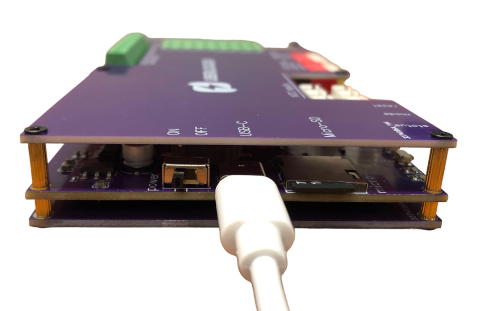
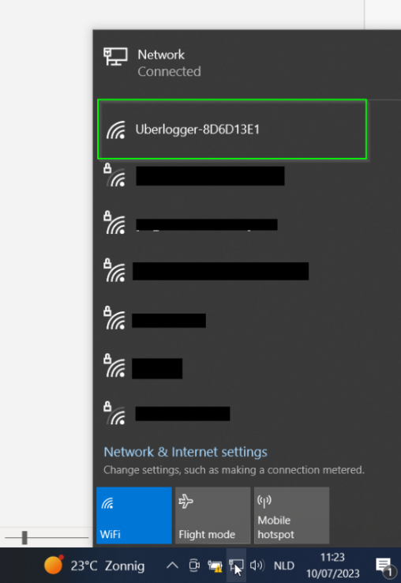
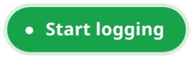
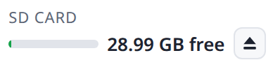
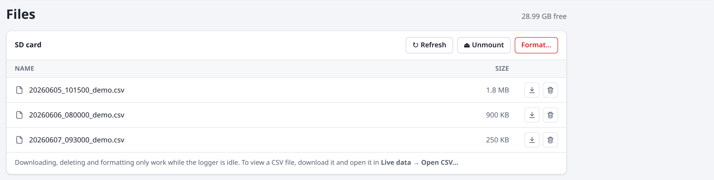
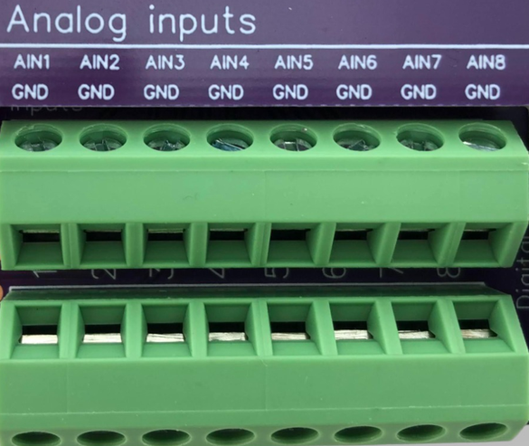
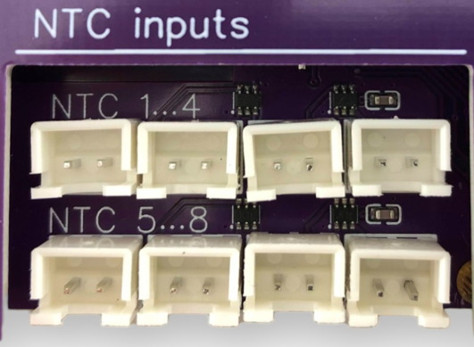
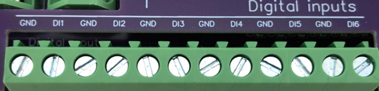

# Quickstart

## Power Up

Connect the provided USB-C cable into the Uberlogger and plug the other end into your PC or a USB charger that provides 5V and at least 300 mA. Flip the power switch to `on` and you should see a green LED light up. Switch the power switch to the `on` state. The green LED should turn on.

Figure 1: connecting the Uberlogger with the USB connector.

## Connect to Wi-Fi & accessing the portal.

From your PC, connect to the Wi-Fi network that reads as
`Uberlogger-XXXXXXXX,` where `XXXXXXXX` represents your unique Uberlogger ID.

Once connected, open your preferred browser, and navigate to
[http://192.168.4.1](http://192.168.4.1/). You should now be viewing the
Uberlogger live data page.

:::info Note
Out of the box, the hotspot is **open** (no Wi-Fi password) and the web
interface requires **no login**. Both can optionally be secured later
from the [Configuration → Network](/Manual/Configuration#network-configuration)
page. If a login has been configured, the browser will prompt for the
username `admin` and the password you set.
:::

## Starting and stopping logging

Put an SD card formatted as FAT partition into the SD card slot on your
Uberlogger.

:::info Note

Currently only SD cards up to 32GB and FAT are supported.

:::

---

- **Start logging** Start the logger by either:

By default the Uberlogger is set to "Continuous measurement" mode. With this you can do the following to start the logger.

1.  Pressing the "mode" button on the side of the Uberlogger for
    about 1 second to start logging.

2.  Pressing **Start logging** in the top right corner of the web
    interface. The button is available on every page:

> 
>
> The green LED on the Uberlogger should blink at an interval of around
> 1 second to indicate it is logging.

- **Stop Logging**: When you are done, you can stop logging by:

  1.  Pressing the mode button for 1 second

  2.  Pressing **Stop logging** in the top right corner. While logging, the
      logger status in the top bar shows **LOGGING**:

> 

## Retrieve your data

Your logged data can be retrieved in the following way.

1.  **Ejecting the SD card:** before you take out the SD card, unmount it
    with the eject icon next to the SD card status at the top of the page
    (or **Unmount** on the `Files` tab). After this you can insert the SD
    card into a PC and retrieve the data from there.

> 

:::danger Important
Do not manually eject the SD-card while the
SD-card is mounted and/or while logging. Failing to do so may
corrupt your data!
:::

2.  **Using the file browser:** you can download the CSV files on the
    `Files` tab. To view a CSV file, open it on the `Live data` tab with
    **Open CSV…**.
    

# Connecting inputs

## Analog inputs

For analog inputs, connect to AINx and its corresponding GND. Each analog input has a ground signal indicated
as GND opposite of the signal as indicated in the figure.

You can connect the analog channel to AINx and its corresponding GND,
which is opposite of the positive terminal as indicated above in red.
The GND and AINx terminal can handle voltages up to -60V and +60V, respectively. You can insert the wire in the screw
terminal by first screwing the terminal open, inserting the wire and
then screwing it tight.

## NTC inputs

Below are the NTC connector inputs shown. The top ones are NTC1 till NTC4. Bottom row NTC5 till NTC8

In case you want to use the NTC, you can plug it directly into the socket you want to. The top 4 connectors are connected to channel 1 to 4 and the bottom 4 connectors to channel 5 to 8, respectively.

## Digital inputs

Digital inputs have the ground to the left of its digital
channel.

One digital channel terminal pair is shown above, where the GND of DIx is left of the positive terminal. Note that the digital inputs can handle voltages of maximal +/- 60V.
