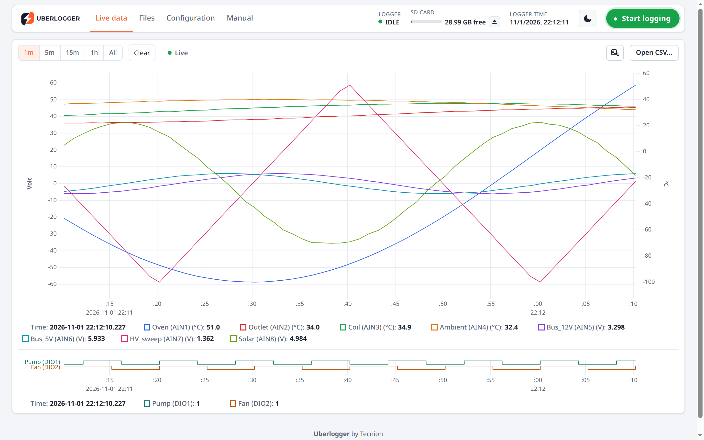
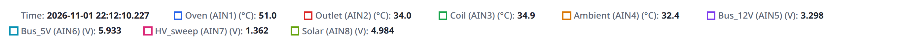
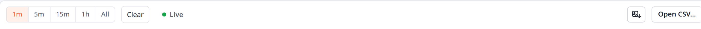
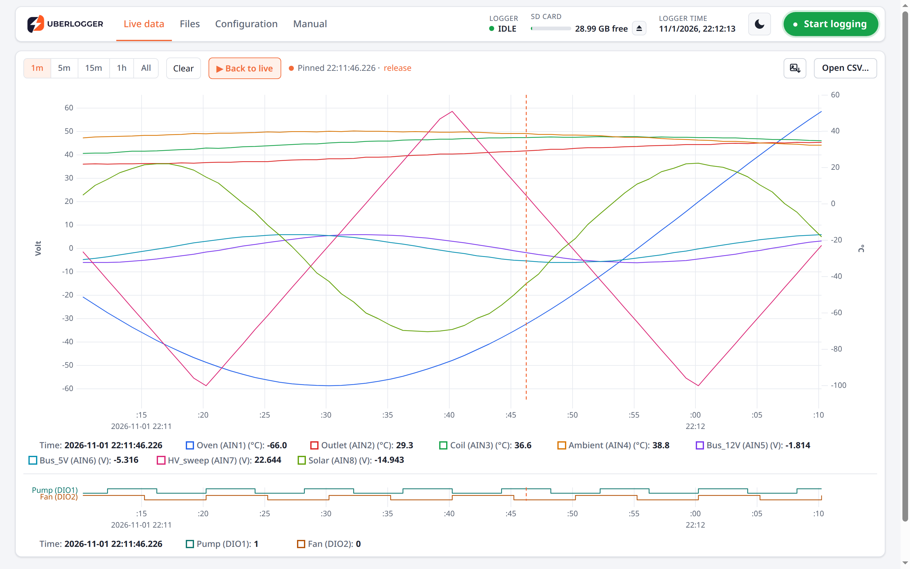
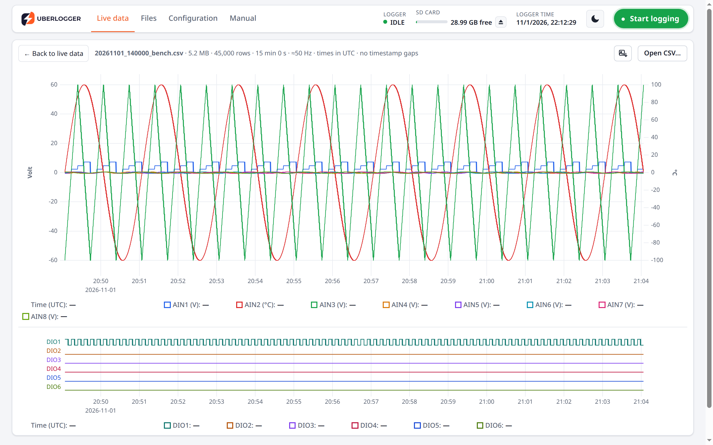
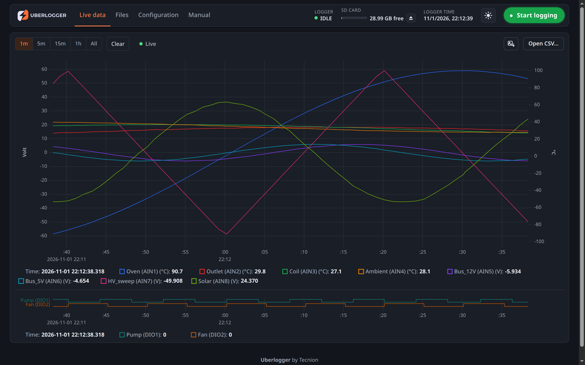

# Live Data viewer

The **Live data** tab shows all enabled channels in one chart: voltages on
the left axis, temperatures (NTC) on the right axis in degrees Celsius, and
the digital inputs as separate lanes below. You also see live values while
logging. The live view refreshes once per second.

From firmware **v1.3.4** on, the same chart also opens CSV log files, see
[Viewing CSV files](#viewing-csv-files).

---

:::info Note

When logging data and having a sample frequency of 1, 2 or 5 Hz, it may take up to 70 seconds before data is shown in the live data viewer.

:::

---

## Live values and channel labels

The values under the chart are the latest reading of each channel. Channels
you have labelled in the [Configuration](../03-Configuration/index.md) are
shown by their label, for example `Oven (AIN1)`. Click a channel name to hide
or show it in the chart.

When you hover the chart, the values show the moment under the cursor
instead.

## Time window

The buttons **1m / 5m / 15m / 1h / All** set how much recent history is
shown. "All" shows the full retained history, up to about 6 hours.

## Inspecting the data

- **Pin a moment:** click (or click and hold) on the chart. The chart stops
  following the live data and a dashed line marks the pinned moment; the
  values under the chart show that moment. Click **release** to remove the pin.
- **Zoom:** drag across the chart or use the scroll wheel. On a phone or
  tablet, use two fingers.
- **Pan:** hold Shift and drag.
- **Back to live:** after pinning or zooming, the **Back to live** button
  (where the Live indicator was) makes the chart follow the newest data again.
  Double-clicking the chart does the same.

## Saving an image

The image button next to **Open CSV…** saves the current chart, including the
channel names and values, as a PNG image.

## Data history

The live chart keeps roughly the last **6 hours** of data per channel.
This history is stored in your browser, so it **survives a page refresh**
and keeps accumulating while you are on other tabs (Files, Configuration).
When the browser was not receiving data for a while, the chart shows a gap.

Use the **Clear** button to empty the stored history and start the live view
from scratch.

## Connection indicator

The dot next to the time window buttons shows the connection to the
Uberlogger: it is **green** while data is received and turns **red**
("connection lost") when the browser can no longer reach the device.

## Viewing CSV files

Use **Open CSV…**, or drop a CSV file anywhere on the page, to view a log
file in the same chart. Download the file from the
[Files](../05-File-browser/index.md) tab first. The file is processed in your
browser; nothing is uploaded to the logger, so this also works for large
files.

- The line above the chart shows the file name, size, number of rows,
  duration and sample rate.
- Times in the file are UTC.
- Gaps in the timestamps are marked with red lines.
- Zooming, pinning and saving an image work as in the live view.
- **Back to live data** returns to the live view.

Very large files need a lot of memory: the viewer warns you before opening a
file that may be too large for your device.

## Dark mode

The moon icon in the top bar switches between a light and a dark theme. Your
choice is remembered in the browser; by default the theme follows your
system setting.

