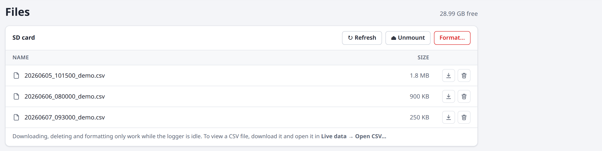

# File browser

The **Files** tab lists the folders and files on the SD card with their
size, and the free space on the card. This requires the SD card to be
inserted and mounted in the Uberlogger.

:::note Note

You can only download, delete, format and unmount while the Uberlogger is
idle, so not while logging, calibrating or formatting the SD card.
:::

- Click a folder to open it. Use the path above the list (**SD card** › …)
  to go back.
- **Download:** click the download icon next to a file. To view a CSV file,
  open it on the Live data tab with **Open CSV…**, see
  [Viewing CSV files](../04-Live-data-viewer/index.md#viewing-csv-files).
- **Delete:** click the trash icon and confirm. From firmware **v1.3.4** on,
  a message tells you when a file could not be deleted.
- **Refresh** reloads the list.

Large folders are split into pages; use the page numbers below the list.

## Formatting the SD card

**Format…** erases all files on the SD card. Formatting may take up to 30
seconds.

## Unmounting the SD card

**Unmount**, or the eject icon next to the SD card status in the top bar,
safely unmounts the SD card so you can take it out of the Uberlogger. To
mount it again, take it out and reinsert it.

The SD card status in the top bar shows how full the card is and how much
space is free.
