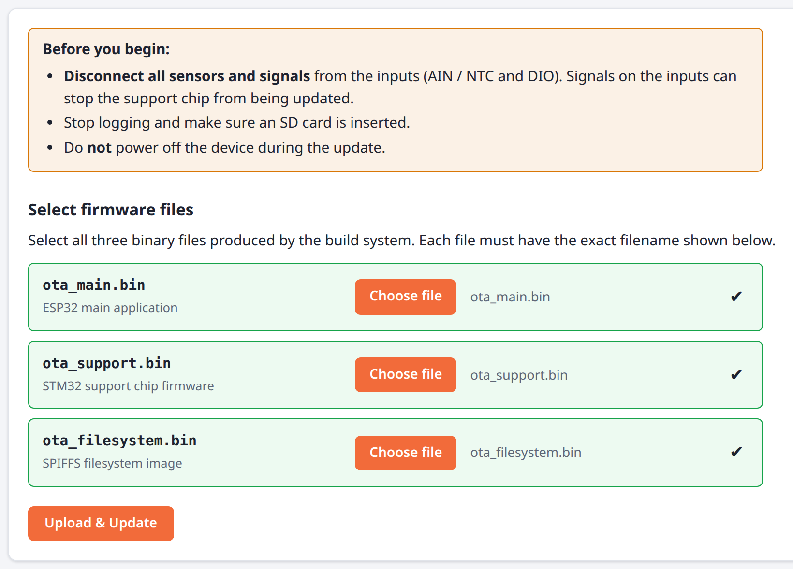
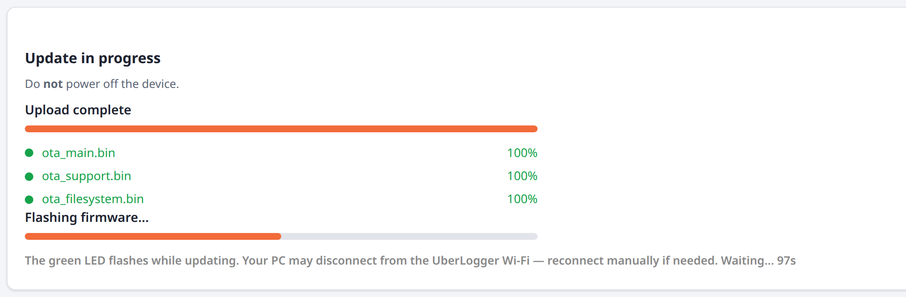
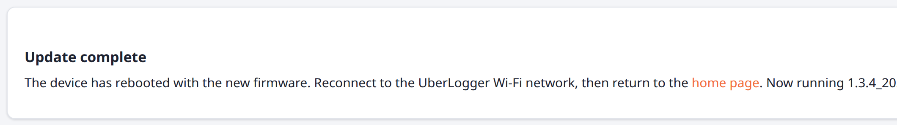

# Firmware update

Firmware updates are installed from the **Firmware Update** page in the web
interface. Download the latest firmware from the Downloads section on the
Uberlogger website:
[www.uberlogger.com/#downloads](https://www.uberlogger.com/#downloads).

A firmware release ships as a zip file containing three binaries that
must all be flashed together:

- **`ota_main.bin`** — ESP32 main application (web server, logger
  logic, REST API).
- **`ota_support.bin`** — STM32 support-chip firmware (ADC sampling,
  digital inputs, RTC).
- **`ota_filesystem.bin`** — filesystem image containing the
  web interface.

:::danger Before you begin

- **Disconnect all sensors and signals from the inputs** (AIN / NTC and
  DIO). Signals on the inputs can stop the support chip from being updated.
- Stop logging and make sure an SD card is inserted.
- Do **not** power off the Uberlogger during the update. This may brick it.

:::

To update the firmware, follow the next steps:

:::note Step 1

- Extract the zip with the firmware files into a directory.
- In the web interface, go to **Configuration** › **System** and click
  **Update firmware**.

:::

:::note Step 2

- Choose the `ota_main.bin`, `ota_support.bin` and `ota_filesystem.bin`
  files for the matching rows. Each row turns green with a check mark when
  the right file is chosen.

:::

:::note Step 3

- Click **Upload & Update** and confirm the message with **OK**.
- The page shows the progress while each file is uploaded, and then while
  the firmware is flashed.
- The green LED on the Uberlogger flashes while the update is in progress.
  The full update typically takes about 70 seconds.
- Your PC may disconnect from the Uberlogger Wi-Fi while the device
  restarts; reconnect manually if needed.

:::

:::note Step 4

- After flashing, the Uberlogger restarts. The page waits up to two minutes
  for it to come back online, and then checks which firmware is running.
- **Update complete** with "Now running …" means the new firmware is
  installed. The green LED is constantly on again.

:::

From firmware **v1.3.4** on, the update files are removed from the SD card
after a successful update.

## If the update fails

If the page shows **Update failed**, the Uberlogger is still running the
previous firmware. Disconnect all sensors and signals from the inputs,
switch the Uberlogger off and on again, and retry the update.

If the page does not report back within two minutes, wait until the green
LED stops flashing, reconnect to the Uberlogger and check the version under
**Configuration** › **System**.

If the update keeps failing, contact
[customer support](https://www.uberlogger.com/contact.html).

:::info Note
If a web-interface login is enabled, the browser may ask you to log in
again after the device has restarted.
:::
